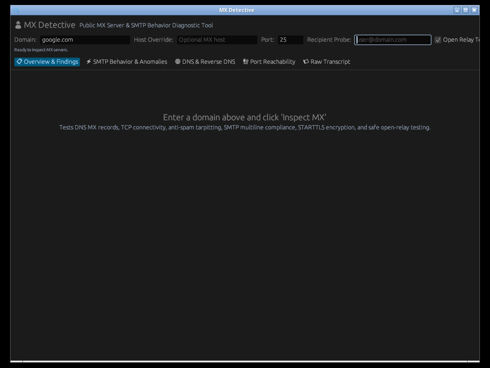

# 🕵️ MX Detective

> **Comprehensive Public MX Server, SMTP Handshake & Protocol Behavior Diagnostic Tool**  
> Written in high-performance, memory-safe **Rust** with native **GUI** (`egui`/`eframe`) and **CLI** interfaces.  
> Supports **Light and Dark modes** across both the graphical interface and exported HTML reports.

[](https://www.rust-lang.org/)
[](LICENSE)
[](https://snyk.io/)
[](https://github.com/mottipython/mx-detective)

---

## 📸 Screenshots

| Overview & Health Score | SMTP Behavior & Anomalies |
|:---:|:---:|
|  |  |

| DNS, PTR & Mail Auth (SPF/DMARC) | Port Reachability (25, 587, 465, 2525) |
|:---:|:---:|
|  |  |

| Detailed Findings & Remediation | Full SMTP Protocol Transcript |
|:---:|:---:|
|  |  |

---

## 🎯 What is MX Detective?

**MX Detective** connects directly to public mail exchanger (MX) servers to diagnose common connection problems and **detect misbehaving, non-compliant, or faulty SMTP responses** that standard email tests overlook. 

Designed for systems administrators, network engineers, IT support specialists, and security auditors who need to pinpoint email delivery failures, firewall blocks, certificate issues, and MTA protocol anomalies.

---

## 🎨 Light & Dark Mode Support

MX Detective includes first-class support for both Light and Dark color schemes:
- **Desktop GUI**: Seamless theme switcher in the navigation bar (🌙 Dark, ☀️ Light, or 🖥 System preference) with optimized contrast palettes for readability.
- **Exported HTML Reports**: Self-contained reports feature an interactive theme toggle button plus automatic adaptation to your operating system via `@media (prefers-color-scheme: light)` CSS.

---

## 🔍 Key Diagnostic Capabilities

### ⚡ Deep SMTP Protocol & Behavior Auditing
- **Banner Tarpitting & Greeting Delay**: Measures exact millisecond timing before the initial `220` greeting arrives; detects artificial anti-spam tarpits (> 3s) that risk triggering sender MTA timeouts.
- **RFC 5321 Multiline Formatting**: Validates strict hyphenation (`250-line`) vs space termination (`250 line`), checks for mismatched status codes between lines, and detects bare line feeds (`\n` without `\r`).
- **Banner FQDN Verification**: Enforces RFC 5321 §4.2 rule requiring the first word of the 220 banner to be the server's fully qualified domain name.
- **Null Sender Bounce Compliance (`MAIL FROM:<>`)**: Checks if the server accepts `<>` (RFC 5321 §3.6 / RFC 1123 §5.2.9). Servers that reject null senders break Delivery Status Notifications (NDR bounces) and create message loops.
- **STARTTLS Negotiation & False Advertising**: Detects servers advertising `STARTTLS` in `EHLO` but erroring (`454`/`500`) or dropping connections when executed.
- **Post-STARTTLS State Reset (RFC 3207 §4.2)**: Verifies that re-issuing `EHLO` after TLS encryption successfully resets session state.
- **Insecure Plaintext Authentication**: Alerts if `AUTH` mechanisms (`PLAIN`, `LOGIN`) are offered over unencrypted port 25 before TLS is negotiated.
- **Safe Open Relay Detection**: Probes `RCPT TO:<relay-test@example.net>` without queuing or sending email; detects catastrophic open-relay vulnerabilities.
- **Message Size Limits**: Parses and converts advertised `SIZE` limits into MB, warning on abnormally restrictive limits (< 5 MB).
- **Session Teardown**: Verifies that `RSET` properly resets state and `QUIT` cleanly returns `221` without abrupt socket drops.

### 🌐 DNS, Reverse DNS & Mail Authentication
- **MX Priority & CNAME Check**: Discovers all MX records, sorts by preference, and flags RFC 2181 / RFC 5321 violations (MX host pointing to a CNAME alias).
- **Null MX Detection (RFC 7505)**: Identifies explicit `MX 0 .` records published by no-mail domains.
- **Forward-Confirmed Reverse DNS (FCrDNS)**: Validates PTR records for each MX IP and verifies the PTR hostname resolves forward back to the same IP.
- **SPF Audit**: Audits `v=spf1` syntax, multiple SPF records (RFC 7208 §3.2 PermError), lookup mechanisms count (max 10 limit), deprecated `ptr` tags, and qualifiers (`-all`, `~all`, `?all`, `+all`).
- **DMARC Audit**: Queries `_dmarc.<domain>`, assesses enforcement policy (`p=reject`, `p=quarantine`, `p=none`), percentage (`pct=`), and aggregate reporting (`rua=`).
- **DKIM Selector Discovery**: Probes user-specified or common DKIM selectors (`google`, `default`, `k1`, `mail`, `selector1`, etc.).

### 🔌 Port Reachability & Local Firewall Diagnostics
- **Multi-Port Probe**: Tests ports **25** (SMTP), **587** (Submission), **465** (SMTPS), and **2525** (Alt SMTP).
- **ISP Port 25 Block Detection**: Accurately detects when outbound TCP port 25 is blocked by residential ISPs (Comcast, AT&T, Spectrum) or cloud firewalls (AWS, Azure, GCP).

---

## 📊 Export in Useful Formats

MX Detective generates structured reports tailored for tickets, compliance, and automation:

| Format | File Extension | Use Case |
|---|---|---|
| **HTML** | `.html` | Standalone, interactive report with health badges, collapsible transcript, Light/Dark toggle, and print-to-PDF stylesheet |
| **Markdown** | `.md` | Formatted for GitHub, GitLab, Jira, Confluence, Linear, and Notion tickets |
| **JSON** | `.json` | Full machine-readable data for CI/CD pipelines, SIEM logging, and API automation |
| **CSV** | `.csv` | Tabular export of checks, anomalies, and port probes for Excel or LibreOffice Calc |
| **Plain Text** | `.txt` | Clean ASCII terminal report for email or command-line archiving |

---

## 🚀 Installation & Packages

Pre-built binaries and native packages are provided for Linux (RPM, DEB, Arch), Windows, and macOS:

### Fedora / RHEL / Rocky / CentOS (`.rpm`)
```bash
sudo rpm -i dist/mx-detective-0.1.0-1.fc44.x86_64.rpm
# or with dnf:
sudo dnf install dist/mx-detective-0.1.0-1.fc44.x86_64.rpm
```

### Debian / Ubuntu (`.deb`)
```bash
sudo dpkg -i dist/mx-detective_0.1.0_amd64.deb
```

### Arch Linux (`.pkg.tar.zst` or PKGBUILD)
```bash
# Direct binary package installation
sudo pacman -U dist/mx-detective-0.1.0-1-x86_64.pkg.tar.zst

# Or build from PKGBUILD:
cd packaging/arch && makepkg -si
```

### macOS (Apple Silicon & Intel)
```bash
# Apple Silicon (M1/M2/M3/M4)
tar -xvf dist/mx-detective-v0.1.0-macos-aarch64.tar.gz
./mx-detective-macos-aarch64/mx-detective --gui

# Intel (x86_64)
tar -xvf dist/mx-detective-v0.1.0-macos-x86_64.tar.gz
./mx-detective-macos-x86_64/mx-detective --gui
```

### Windows (64-bit)
1. Download `mx-detective-v0.1.0-windows-x86_64.zip`.
2. Extract the archive.
3. Double-click `mx-detective.exe` to launch the GUI, or run via PowerShell:
```powershell
.\mx-detective.exe example.com
```

### Standalone Linux Tarball
```bash
tar -xvf dist/mx-detective-v0.1.0-linux-x86_64.tar.gz
cd mx-detective-linux-x86_64
./mx-detective --help
```

### Build from Source
```bash
cargo build --release
./target/release/mx-detective --help
```

---

## 💻 CLI Usage & Examples

### Basic Domain Diagnostic
```bash
mx-detective google.com
```

### Direct Connection to Specific MX Host
```bash
mx-detective example.com --host mail.example.com --port 25
```

### Test Recipient Mailbox Acceptance
```bash
mx-detective example.com --recipient admin@example.com
```

### Export Reports in Different Formats
```bash
# Export interactive HTML report
mx-detective example.com --export report.html

# Export Markdown report for a GitHub/Jira issue
mx-detective example.com --export report.md

# Export CSV for spreadsheet review
mx-detective example.com --export report.csv

# Output JSON to stdout or file
mx-detective example.com --json > report.json
```

---

## 🖥️ Graphical Interface (GUI)

Launch the native desktop GUI by adding `--gui`:
```bash
mx-detective --gui
# or pass a domain directly:
mx-detective google.com --gui
```

### GUI Features:
- **Interactive Top Bar**: Real-time domain and MX override inputs.
- **Theme Switcher**: Instant switching between 🌙 Dark, ☀️ Light, and 🖥 System theme.
- **Score Header**: Circular health score (0-100) and letter grade (A+ to F).
- **5 Comprehensive Tabs**:
  1. **📋 Overview & Findings**: Issues prioritized by severity with actionable remediation steps.
  2. **⚡ SMTP Behavior & Anomalies**: Detected RFC violations, banner latency, tarpit detection, and ESMTP chips.
  3. **🌐 DNS & Reverse DNS**: MX priority table, PTR resolution, SPF mechanisms, and DMARC configuration.
  4. **🔌 Port Reachability**: Latency table for ports 25, 587, 465, and 2525.
  5. **📜 Raw Transcript**: Microsecond-stamped sent (`->`) and received (`<-`) SMTP packet stream with one-click clipboard copying.
- **One-Click Export**: Save reports directly as HTML, Markdown, CSV, JSON, or Text from the UI.

---

## 🔒 Security & Code Audit (Snyk Tested)

Tested with **Snyk CLI** (Static Code Analysis / SAST):
```
Testing /home/motti/projects/mx-detective ...

╭───────────────────────────────────────────────────────────╮
│ Test Summary                                              │
│                                                           │
│   Test type:         Static code analysis                 │
│   Project path:      /home/motti/projects/mx-detective    │
│                                                           │
│   Total issues:   0                                       │
╰───────────────────────────────────────────────────────────╯
```
✅ **0 Security Vulnerabilities Detected**

---

## 📦 Multi-Platform Release Matrix (OSX / Windows / Linux / Arch / RPM / DEB)

The repository includes a production-ready GitHub Actions matrix workflow at `.github/workflows/release.yml`:
- **Linux**: Automates `.rpm` (Fedora/RHEL), `.deb` (Debian/Ubuntu), Arch (`.pkg.tar.zst`), and `.tar.gz` releases.
- **macOS (OSX)**: Native builds for both **Apple Silicon** (`aarch64-apple-darwin`) and **Intel** (`x86_64-apple-darwin`).
- **Windows**: Native 64-bit build (`x86_64-pc-windows-msvc` / `x86_64-pc-windows-gnu`) packaged as `.zip` containing `mx-detective.exe`.

To package all distributions locally:
```bash
./build-packages.sh
```

---

## 📜 License
MIT License. Created by Motti Schleider.
