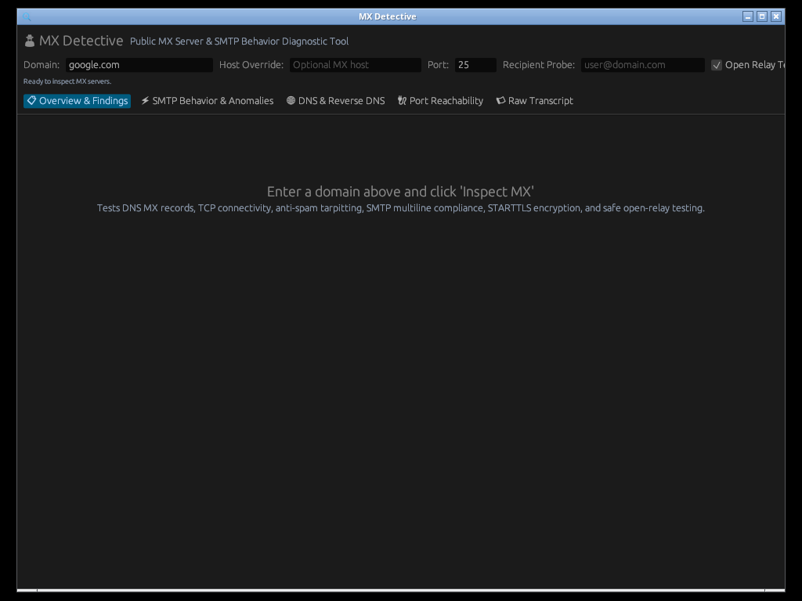

# MX Detective

Checks a domain's mail setup from the outside: it finds every MX server, connects to each address over IPv4 and IPv6, and reports what a sending server would run into. It has a command-line mode and a desktop window, and exports reports as HTML, Markdown, JSON, CSV or text.

[](https://github.com/mottipython/mx-detective/actions/workflows/ci.yml)
[](https://github.com/mottipython/mx-detective/actions/workflows/security.yml)
[](LICENSE)

| Overview & Health Score | SMTP Behavior & Anomalies |
|:---:|:---:|
|  |  |

## Install

<!-- install:start -->
Latest release: **v1.2.0**, see the [release page](https://github.com/mottipython/mx-detective/releases/tag/v1.2.0) for notes and checksums. This section is regenerated on every release.

**Windows installer.** Download [mx-detective-setup-windows-x86_64.exe](https://github.com/mottipython/mx-detective/releases/download/v1.2.0/mx-detective-setup-windows-x86_64.exe) and run it: a Start menu entry for the window, an optional PATH entry, and an uninstaller in Settings. It installs for your user, no administrator rights needed. For scripts and RMM tools add `/VERYSILENT`.

**Windows** (PowerShell). Installs the portable executable for your user and adds it to your PATH, without an installer. Run the same line again to update.

```powershell
irm https://raw.githubusercontent.com/mottipython/mx-detective/master/install.ps1 | iex
```

Or just download the single `.exe` and run it, nothing installed:

```powershell
irm https://github.com/mottipython/mx-detective/releases/download/v1.2.0/mx-detective-windows-x86_64.exe -OutFile mx-detective.exe; .\mx-detective.exe example.com
```

**Linux and macOS.** Installs to `~/.local/bin` (or `/usr/local/bin` as root) after checking the checksum. Run the same line again to update.

```bash
curl -fsSL https://raw.githubusercontent.com/mottipython/mx-detective/master/install.sh | sh
```

**Linux packages** for v1.2.0:

```bash
# Debian, Ubuntu
curl -fLO https://github.com/mottipython/mx-detective/releases/download/v1.2.0/mx-detective_1.2.0_amd64.deb && sudo apt install ./mx-detective_1.2.0_amd64.deb

# Fedora, RHEL, Rocky
sudo dnf install https://github.com/mottipython/mx-detective/releases/download/v1.2.0/mx-detective-1.2.0-1.x86_64.rpm

# Arch
curl -fLO https://github.com/mottipython/mx-detective/releases/download/v1.2.0/mx-detective-1.2.0-1-x86_64.pkg.tar.zst && sudo pacman -U mx-detective-1.2.0-1-x86_64.pkg.tar.zst
```

**A specific version** (for example to keep a fleet on one release):

```powershell
& ([scriptblock]::Create((irm https://raw.githubusercontent.com/mottipython/mx-detective/master/install.ps1))) -Version v1.2.0
```

```bash
curl -fsSL https://raw.githubusercontent.com/mottipython/mx-detective/master/install.sh | MX_DETECTIVE_VERSION=v1.2.0 sh
```

**Check it worked:** `mx-detective --version`. **Uninstall:** Settings > Apps for the installer, or delete `mx-detective.exe` from `%LOCALAPPDATA%\Programs\mx-detective` (Windows) or `mx-detective` from `~/.local/bin`; packages are removed with your package manager.
<!-- install:end -->

## Usage

```bash
mx-detective example.com                         # test every MX server of the domain
mx-detective example.com --primary-only          # only the most preferred MX host
mx-detective example.com --host mail.example.com # test one specific server
mx-detective example.com --recipient me@example.com   # is this mailbox accepted?
mx-detective example.com --dkim-selector mysel1,mysel2
mx-detective example.com -o report.html          # also .md .json .csv .txt
mx-detective --gui                               # open the window
```

`mx-detective --help` explains every option, the exit codes and the keys below, with examples.

## Scripting and automation

Built to be called from scripts, RMM tools such as NinjaOne, and CI jobs. There are no prompts, nothing is installed or changed on the machine, and what a script reads is stable.

**Ask for what you need**

| Option | Output on stdout |
|---|---|
| *(none)* | the full text report |
| `--summary` | one `key=value` line per fact (keys below) |
| `--get KEY` | only the value of one key, for example `--get grade` prints `A` |
| `--json` | the complete result as JSON |

`-o FILE` additionally saves a report; the format follows the extension (`.html` `.md` `.json` `.csv` `.txt`).

Output on stdout is plain ASCII whatever the console code page (JSON uses `\u` escapes), and progress goes to stderr, and only when stderr is a terminal. A script that captures both streams gets the answer and nothing else. `--quiet` hides progress on a terminal too. Colors appear only on a terminal and `NO_COLOR` turns them off.

**Gate on the result**

| Exit code | Meaning |
|---|---|
| `0` | finished, and nothing is at or above `--fail-on` (always `0` without `--fail-on`) |
| `1` | finished, and at least one finding is at or above `--fail-on critical\|warning\|notice` |
| `2` | command line error |
| `3` | could not finish: `--max-time` (default 300 seconds, `0` for no limit) ran out, or a report file could not be written |

A domain that cannot receive mail is an answer, not an error: it shows up as a Critical finding, so use `--fail-on critical`.

**PowerShell**

```powershell
$grade = mx-detective.exe example.com --get grade
$r = mx-detective.exe example.com --json | ConvertFrom-Json
"$($r.domain): grade $($r.grade), score $($r.score)/100"

mx-detective.exe example.com --fail-on warning --quiet
if ($LASTEXITCODE -eq 1) { Write-Output 'mail setup needs attention' }

# a script host that stores custom fields, one value each
$expires = mx-detective.exe example.com --get cert_days_left
```

A complete example that scans, prints facts and findings, compares with the previous run and sets the exit code is in [`examples/Invoke-MxHealthCheck.ps1`](examples/Invoke-MxHealthCheck.ps1) (Windows PowerShell 5.1 and PowerShell 7). Run it with `-SelfTest` to check that mx-detective behaves as documented; CI does this on every push.

**sh**

```bash
mx-detective example.com --fail-on critical --quiet || echo "critical mail problem"
grade=$(mx-detective example.com --get grade)
mx-detective example.com --summary | grep ^cert_days_left=
```

**Keys for `--summary` and `--get`.** Values never contain spaces or newlines; an empty value means not applicable or not measured.

| Key | Meaning |
|---|---|
| `domain` | the domain that was checked |
| `tool_version` | version of mx-detective that produced the result |
| `score` | health score, 0-100 |
| `grade` | letter grade: A+, A, B, C, D or F |
| `critical` | number of Critical findings |
| `warning` | number of Warning findings |
| `notice` | number of Notice findings |
| `pass` | number of checks that passed |
| `critical_ids` | comma-separated IDs of the Critical findings |
| `warning_ids` | comma-separated IDs of the Warning findings |
| `mx_hosts` | number of MX hosts the domain publishes |
| `servers_tested` | number of server addresses tested |
| `starttls_servers` | number of servers that offer STARTTLS |
| `open_relay` | true if any server accepted a relay test |
| `port25` | open, closed or untested |
| `spf` | present or missing |
| `spf_lookups` | DNS lookups the SPF record needs, of 10 allowed |
| `dmarc_policy` | none, quarantine, reject or missing |
| `dkim_keys` | number of active DKIM keys found under common selectors |
| `mta_sts` | enforce, testing, none or missing |
| `dane` | true if any MX host publishes TLSA records |
| `dnssec` | signed, unsigned or unknown |
| `blocklisted` | number of blocklist listings for the MX addresses |

With `--baseline` or `--diff` (below) four more keys are added: `changes`, `regressions`, `improvements`, and `regression_ids` (comma-separated IDs of what got worse).

In `--json`, `tool_version` identifies the build and the field names are kept stable within a major version.

## Comparing with an earlier run

Save a result, run again later, and see what changed. Good for drift alerts from a scheduled job, and for checking a DNS or mail migration before and after.

```bash
mx-detective example.com --json > last.json                      # the baseline
mx-detective example.com --baseline last.json --fail-on regression  # later: what got worse?
mx-detective --diff last.json now.json                           # compare two saved results, no network
```

A change is a finding that appeared, went away or changed severity, or a difference in the MX list, SPF, DMARC, DKIM keys, MTA-STS, blocklist listings, or any server's reachability, TLS version, cipher or certificate. Things that differ on every run (latency, days left on a certificate, wording) are ignored, and so are Pass and Info findings coming and going. A renewed certificate shows as one fingerprint change.

- `--diff-only` prints just the changes; `--ignore ID,ID` drops changes whose ID starts with one of them.
- `--fail-on regression` exits 1 if anything got worse than the baseline; the exit codes are otherwise unchanged. A baseline that cannot be read, or is for another domain, exits 2.
- `--json` adds a `diff` object; `-o report.html` / `.md` get a changes section.

```powershell
$worse = mx-detective.exe example.com --baseline C:\ProgramData\mx\last.json --get regression_ids
if ($worse) { Write-Output "mail setup got worse: $worse" }
mx-detective.exe example.com --json | Set-Content C:\ProgramData\mx\last.json
```

## What it checks

**Every MX address, in parallel.** Up to four IPv4 and four IPv6 addresses per MX host. Identical findings across servers are merged ("all 10 servers"), and servers behind one name that behave differently are flagged.

**SMTP behavior**
- Greeting delay (tarpit), banner FQDN, CRLF line endings, multiline reply format
- `EHLO` / `HELO` fallback, advertised `SIZE`, `PIPELINING`, `CHUNKING`, `SMTPUTF8`
- `AUTH` offered before TLS
- Null sender (`MAIL FROM:<>`) accepted, as RFC 5321 requires
- `postmaster@` accepted, unknown recipients rejected at `RCPT` time (backscatter and catch-all), greylisting
- Open relay (never sends a message; always `RSET`)
- `VRFY` / `EXPN` exposure, `RSET` and `QUIT` behavior
- Optional mailbox probe with `--recipient`

**TLS** (from the certificate and session the server actually presents)
- Protocol version and cipher, certificate subject, issuer, SANs, expiry, chain trust and hostname match
- `STARTTLS` advertised but failing, plaintext data injected after the `220` reply, re-`EHLO` after TLS
- DANE: TLSA records matched against the presented chain; DNSSEC status of the records
- MTA-STS: TXT record, policy file, mode, `max_age`, MX patterns against the real MX hosts, and whether TLS would actually pass in enforce mode
- TLS-RPT

**DNS and mail authentication**
- MX list, null MX, MX pointing at a CNAME, A and AAAA records, PTR and forward-confirmed reverse DNS
- SPF with the full include/redirect tree counted against the 10-lookup limit, void lookups, `ptr`, `all`
- DMARC policy, `pct`, `sp`, alignment, and whether external `rua`/`ruf` addresses have authorized reports
- DKIM: about 95 common selectors tried in parallel, key type and size, revoked keys, wildcard records; add your own with `--dkim-selector`
- DNSSEC, BIMI
- DNS blocklists (Spamhaus, Barracuda, SpamCop, PSBL) for every MX address

**Network**: ports 25, 587, 465 and 2525, and whether outbound port 25 looks blocked.

Findings are Critical, Warning, Notice, Info or Pass and roll up into a score and grade.

## Window

`mx-detective --gui`, or double-click `mx-detective.exe` on Windows. Tabs: findings, SMTP behavior, servers and TLS (one row per address), DNS, ports, and the raw transcript of any server's session. Light and dark themes; export from the menu.

It needs no graphics driver. On Windows it always draws on the CPU, so it opens in virtual machines, remote desktop sessions and fresh installs. On Linux and macOS it uses OpenGL when that works and switches to the CPU renderer on remote displays; `MX_DETECTIVE_SOFTWARE_RENDER=1` forces the CPU renderer there. If the window cannot open at all, the command line still works.

## Notes

- Outbound port 25 is blocked on most home and cloud networks. The tool says so (`port25=closed`); mail to the domain may still work fine.
- The Spamhaus lists refuse queries from public or busy resolvers. Those lists are reported as "could not be checked", not as clean.
- DNSSEC status needs a validating resolver. If none answers, the result is "unknown", not "unsigned".
- Only probe servers you are responsible for or have permission to test. Everything the tool sends is a normal SMTP command; it never sends `DATA`.

## Security

See [SECURITY.md](SECURITY.md) for how to report a problem and how the project is checked (CI, `cargo audit`, Snyk, fuzzing, Dependabot).

## License

MIT. Created by Motti Schleider.
